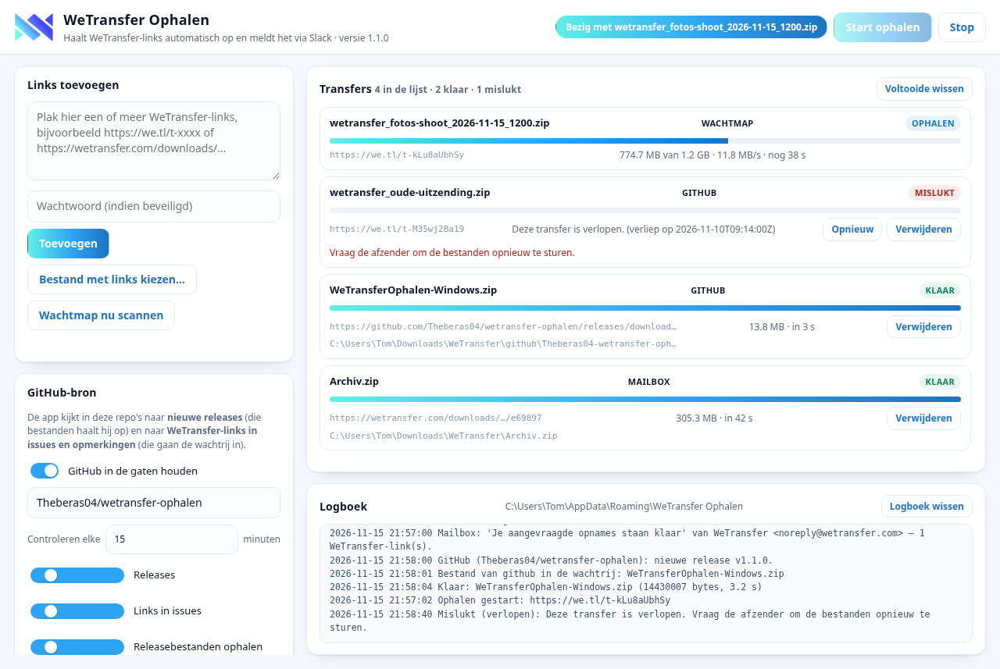

# WeTransfer Ophalen

Een Windows-app die WeTransfer-links automatisch ophaalt en daarna een berichtje
naar Slack stuurt. Plak een link (of laat hem in de wachtmap vallen), en de app
regelt de rest — ook als een download halverwege afbreekt. De app kijkt daarnaast
zelf naar een **GitHub-repo** (nieuwe releases en links in issues) en naar je
**mailbox** (de WeTransfer-mails van je aangevraagde opnames), en is te gebruiken
vanaf elk apparaat in je netwerk via een **webadres op een IP**.



## Wat de app doet

- **Links ophalen van elke WeTransfer-vorm**: `https://we.tl/t-…`, `https://wetransfer.com/downloads/…`
  (met of zonder ontvanger-id) en een al ondertekende `download.wetransfer.com`-link.
- **Automatisch oppakken**: zet een opgeslagen e-mail of tekstbestand met een link in de
  wachtmap en de app begint vanzelf. Verwerkte bestanden gaan naar de submap `verwerkt`.
- **Hervatten**: bij een afgebroken verbinding of een verlopen downloadlink vraagt de app
  een nieuwe link aan en gaat verder met een `Range`-verzoek. Halve downloads blijven als
  `.wetransfer.part` staan, dus na een herstart gaat hij verder waar hij gebleven was.
- **Slack-melding** per opgehaalde transfer, plus een samenvatting als de hele wachtrij
  klaar is. Bij een fout krijg je de reden in het bericht (bijvoorbeeld "Deze transfer is verlopen").
- **Wachtwoord-beveiligde transfers**: vul het wachtwoord in bij het toevoegen van de link.
- **Nette bestandsnamen**: de naam die WeTransfer zelf meegeeft, ontdaan van tekens die
  Windows niet accepteert; een bestaand bestand wordt nooit overschreven (`Archiv (2).zip`).
- **Logboek** in `%APPDATA%\WeTransfer Ophalen\app.log`, plus een venster met de laatste regels.
- **Start mee met Windows** (optioneel) en een geluidje als een download klaar is.
- **Webversie**: dezelfde pagina op `http://<ip-van-je-pc>:8756`, dus ook op je telefoon.
  Beveiligd met een toegangscode die je één keer intoetst.
- **GitHub-bron**: kijk in een repo naar nieuwe releases (die bestanden worden opgehaald)
  en naar WeTransfer-links in issues, pull requests en opmerkingen.
- **Mailbox-bron**: lees de WeTransfer-mails (bijvoorbeeld van een aangevraagde overdracht)
  en haal de link eruit. Alleen lezen: niets wordt verwijderd of als gelezen gemarkeerd.

## Webversie op een IP-adres

Zet in de app **Webversie (via een IP-adres) → Webversie aan**. Het adres staat erbij
(bijvoorbeeld `http://192.168.1.42:8756`) en de toegangscode ook. Open dat adres op je
telefoon, typ de code één keer in en je hebt dezelfde app: links toevoegen, de wachtrij
bekijken, bronnen controleren.

- Windows vraagt de eerste keer om toestemming voor het netwerk (openbaar/privé); kies
  **privé** en sta het toe, anders komt de telefoon er niet bij.
- Vraagt Windows niets en kom je er niet bij, voeg dan eenmalig een regel toe in een
  opdrachtvenster **als administrator**:
  `netsh advfirewall firewall add rule name="WeTransfer Ophalen" dir=in action=allow protocol=TCP localport=8756`
- Zonder venster (bijvoorbeeld op een pc die je niet aanraakt) start je alleen de webversie:
  `"WeTransfer Ophalen.exe" --serve --web --port 8756`.
- Laat je de toegangscode leeg, dan staat de pagina open voor iedereen in je netwerk.
  Dat is op een thuisnetwerk te doen, maar de code is de rem erop.

## GitHub-bron

Zet **GitHub-bron → GitHub in de gaten houden** aan en vul de repo in als `eigenaar/repo`
(meerdere mag, gescheiden door een komma). Standaard staat de repo van de app zelf erin.

- **Releases**: bij een nieuwe release worden de bestanden uit die release opgehaald naar
  `...\WeTransfer\github\<eigenaar>-<repo>\<versie>\`. De eerste controle van een repo legt
  alleen een ijkpunt vast — anders zou de app bij het toevoegen meteen alle oude versies
  binnenhalen. Daarna is elke nieuwe release raak.
- **Links**: WeTransfer-links in issues, pull requests en opmerkingen gaan de wachtrij in.
  Bestaande links worden bij de eerste controle wél meteen opgehaald.
- Zonder toegangssleutel mag GitHub 60 verzoeken per uur; met een fijnmazige tussenpoos
  (standaard 15 minuten) is dat ruim genoeg. Voor een privérepo of meer ruimte vul je een
  **toegangssleutel** in (een fine-grained token met alleen leestoegang).

## Aangevraagde opnames: via je mailbox

WeTransfer stuurt je een e-mail zodra er iets binnenkomt bij een **aangevraagde overdracht**
(*Request files*). Die bestanden staan in het tabblad *Received* van je WeTransfer-account, en
daar is van buitenaf niet bij te komen: de publieke WeTransfer-API is gesloten ("New accounts
cannot be created") en gaat alleen over transfers die je zelf maakt en over boards. Een
API-sleutel levert je aangevraagde opnames dus niet op — de mail van WeTransfer is de route
die wél werkt.

Vul bij **Aangevraagde opnames (mailbox)** je **e-mailadres** en een **app-wachtwoord** in.
De mailserver wordt uit je adres gehaald (`@gmail.com` → `imap.gmail.com`, `@icloud.com` →
`imap.mail.me.com`); je kunt hem ook zelf invullen. Poort 993, map `INBOX`, afzender-filter
`wetransfer` (WeTransfer mailt vanaf `noreply@wetransfer.com`) en 30 dagen terug zijn de
standaardwaarden.

**Gmail in vier stappen:**

1. Zet tweestapsverificatie aan op je Google-account (verplicht voor app-wachtwoorden).
2. Ga naar <https://myaccount.google.com/apppasswords>.
3. Typ een naam (bijvoorbeeld *WeTransfer Ophalen*) en klik op **Maken**.
4. Kopieer het wachtwoord van 16 letters en plak het in de app bij **App-wachtwoord**.
   De spaties die Google toont mogen blijven staan; de app probeert het automatisch ook
   zonder spaties. Je gewone Gmail-wachtwoord werkt hier niet.

De app zoekt in die map naar mail van WeTransfer, haalt de downloadlink eruit en zet hem in de
wachtrij. Welke berichten al bekeken zijn staat in `%APPDATA%\WeTransfer Ophalen\mailbox.json`.

Let op: **Microsoft 365 laat geen IMAP met een gewoon wachtwoord meer toe.** Vul je een
Outlook-, Hotmail- of Live-adres in, dan zegt de app dat meteen in plaats van te blijven
proberen. Laat je WeTransfer-mails in dat geval doorsturen naar een Gmail- of iCloud-adres.

## Installeren

1. Download `WeTransferOphalen-Windows.zip` en pak hem uit (bijvoorbeeld naar
   `C:\Program Files\WeTransfer Ophalen` of gewoon in je Documenten).
2. Start `WeTransfer Ophalen.exe`.
3. **Laat `WeTransfer Ophalen.exe.config` naast de .exe staan.** Zonder dat bestand weigert
   Windows de app te starten zodra hij uit een gedownloade ZIP komt (het "Mark of the Web").
   Windows zal bij de eerste start om bevestiging vragen (SmartScreen → *Meer informatie* →
   *Toch uitvoeren*), omdat de app niet ondertekend is.

Er is geen installatieprogramma en er is niets nodig van Python of .NET: alles zit in de map.

## Slack-melding instellen

1. Ga naar <https://api.slack.com/apps> → **Create New App** → **From scratch**.
2. Kies je werkruimte en een naam, bijvoorbeeld *WeTransfer Ophalen*.
3. Klik links op **Incoming Webhooks** en zet de schakelaar aan.
4. Klik op **Add New Webhook to Workspace**, kies het kanaal (een DM aan jezelf werkt ook)
   en geef toestemming.
5. Kopieer de webhook-URL, plak hem in de app bij **Slack-melding** en klik op
   **Testbericht sturen**.

De webhook staat in `%APPDATA%\WeTransfer Ophalen\settings.json` en gaat nergens anders heen
dan naar Slack.

## Hoe het werkt

WeTransfer heeft geen openbare API om andermans transfers op te halen. De app doet daarom
precies de twee verzoeken die de knop *Downloaden* op wetransfer.com zelf doet:

1. `POST https://wetransfer.com/api/v4/transfers/<id>/prepare-download` met het security-hash
   uit de link → status van de transfer (klaar, verlopen, wachtwoord), de aanbevolen
   bestandsnaam en de grootte.
2. `POST https://wetransfer.com/api/v4/transfers/<id>/download` → `direct_link`, een
   ondertekende link naar `download.wetransfer.com` die ongeveer tien minuten geldig blijft.

Daarna downloadt de app die link in brokken van 256 kB, met voortgang, snelheid en
tijdsindicatie in het venster.

## Ontwikkelen

```bash
python -m pip install -r requirements.txt
python -m unittest discover -s tests -v        # 139 tests, geen internet nodig
python main.py                                  # de app starten vanaf de broncode
python main.py --serve --web --port 8756        # alleen de webversie, zonder venster
python main.py --selftest rapport.json --core-only   # de kern testen (zonder venster)
```

De tests en de zelftest draaien tegen `wtdl/mock.py`: een lokale nabootser van WeTransfer en
Slack. Daardoor is de uitslag niet afhankelijk van internet of van een bestaande transfer.

Windows-build (werkt lokaal precies als in CI):

```bat
build_windows.bat
```

Dat maakt `dist\WeTransfer Ophalen\`, inclusief het pictogram uit `branding/app.ico` en de
`.exe.config`. CI (`.github/workflows/windows-build.yml`) draait de tests, bouwt de app,
draait de **zelftest van de gebouwde .exe** vanuit een map die als "gedownload" is gemarkeerd
en publiceert de ZIP als artifact en als GitHub-release.

Wat die zelftest bewijst, met de gebouwde .exe:

- een echte download tegen de nabootser, met controle van de sha256 van de inhoud;
- hervatten vanaf een half bestand, met een `Range`-verzoek vanaf de juiste byte;
- de foutafhandeling bij een verlopen transfer;
- links uit een bestand in de wachtmap halen en het bestand naar `verwerkt` verplaatsen;
- de wachtrij met Slack-meldingen (één per transfer, plus de samenvatting);
- de webversie: dat hij zonder toegangscode dicht blijft, dat inloggen een cookie zet, dat de
  pagina en de status eruit komen en dat een link die je vanaf het web toevoegt in de wachtrij
  belandt;
- de GitHub-bron: dat de eerste controle een ijkpunt vastlegt, dat een nieuwe release de
  bestanden in de wachtrij zet, dat zo'n bestand echt op schaal binnenkomt (sha256-controle),
  dat een link in een issue wordt opgepakt en dat de Slack-melding "Bestand opgehaald" verstuurd
  wordt;
- de mailbox-bron: dat een WeTransfer-mail wordt gelezen (alleen-lezen), dat de link in de
  wachtrij komt en dat dezelfde mail niet twee keer wordt opgepakt;
- dat het venster opent, dat de pagina zijn eigen JavaScript heeft geladen en dat de
  mapkiezer op de GUI-thread wordt geopend (WinForms weigert dat anders, en dan doet de
  knop niets).

## Beperkingen

- Alleen Windows (de app gebruikt pywebview met de Edge/WebView2-engine; Windows 10 en 11
  hebben die standaard).
- De webversie is bedoeld voor je eigen netwerk, niet voor het open internet: er is geen
  https en geen wachtwoordbeheer, alleen een toegangscode. Deel het adres niet buiten je huis.
- De mailbox gebruikt IMAP met een wachtwoord of app-wachtwoord. Microsoft 365 doet daar niet
  meer aan mee; Gmail en iCloud werken met een app-wachtwoord.
- De webhook, het app-wachtwoord en de GitHub-sleutel staan leesbaar in
  `%APPDATA%\WeTransfer Ophalen\settings.json`. Dat bestand hoort bij jou te blijven.
- De app leunt op dezelfde niet-openbare endpoints als de website. Verandert WeTransfer die,
  dan moet de app mee. Een link die niet meer bestaat of verlopen is, levert een duidelijke
  melding op in plaats van een crash.
- Voor de *Received*-tab van je WeTransfer-account (aangevraagde overdrachten) bestaat geen
  openbare weg: de publieke API is gesloten en gaat niet over ontvangen transfers. Daarom loopt
  dat via de mail die WeTransfer je stuurt.
- Geen automatische updates: een nieuwe versie is een nieuwe ZIP.
- Bij een transfer met meerdere bestanden levert WeTransfer één ZIP; dat is precies wat de
  app binnenhaalt.

## Licentie

Alle rechten voorbehouden. Dit is eigen werk van Werdens Media; er is **geen code van derden**
in overgenomen. De functionele inspiratie voor het omgaan met WeTransfer-links komt van het
open-sourceproject [transferwee](https://github.com/iamleot/transferwee), en de gebruikte
endpoints komen uit de JavaScript-bundel van wetransfer.com zelf. Er is geen regel code uit
die projecten overgenomen.
